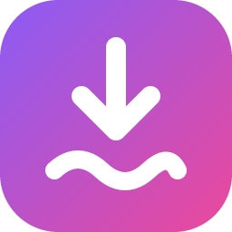
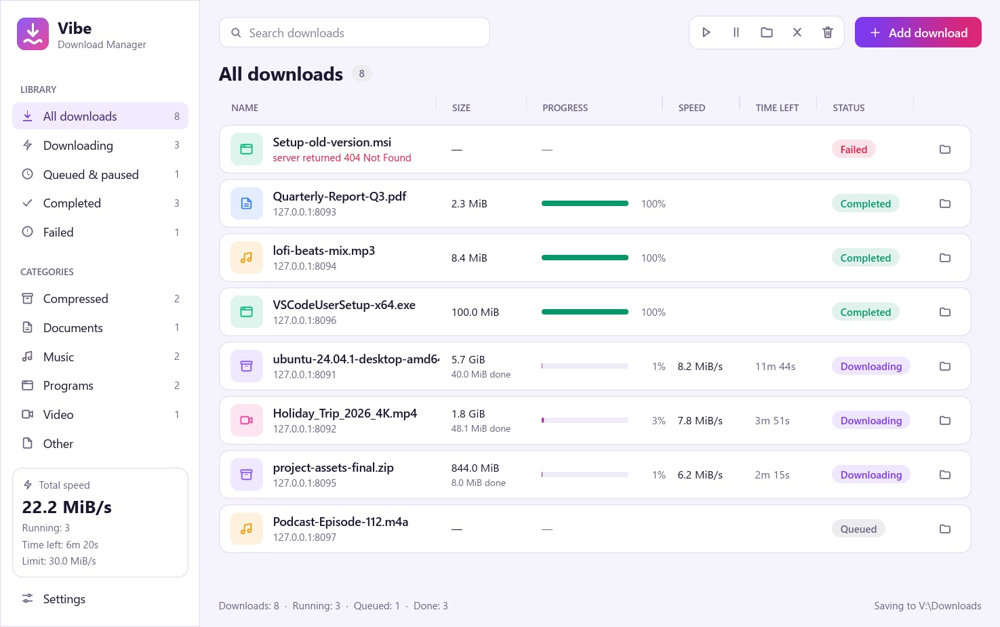
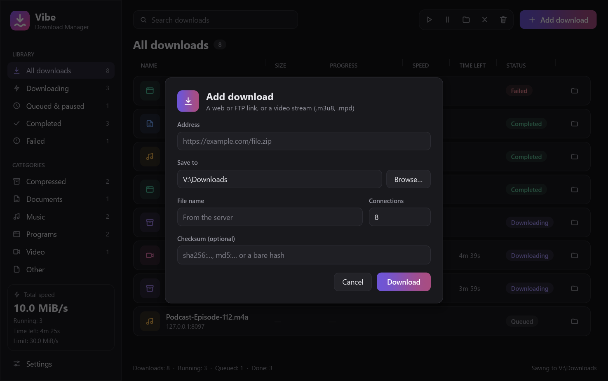
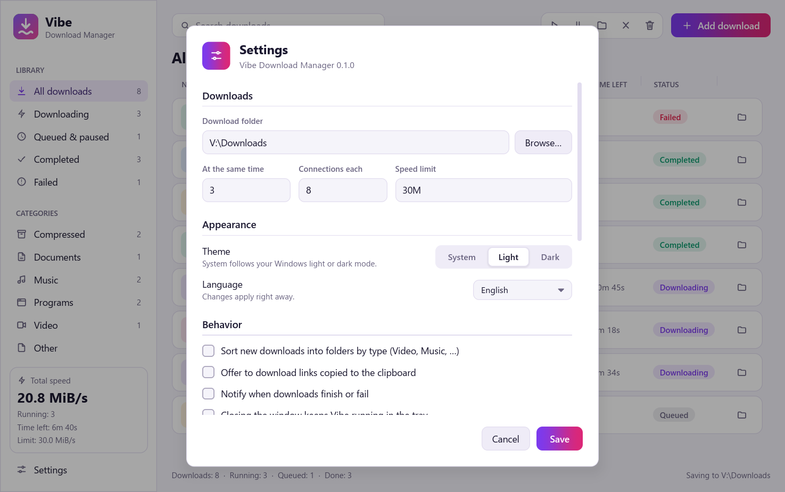
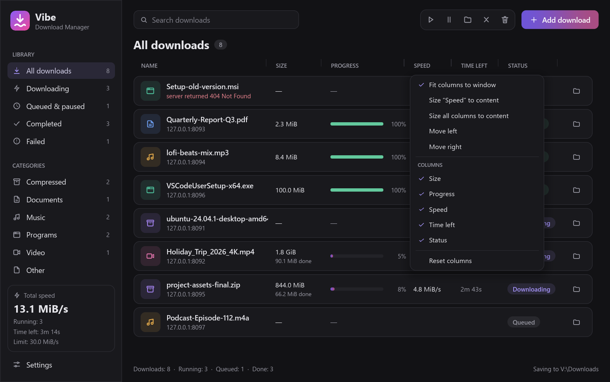
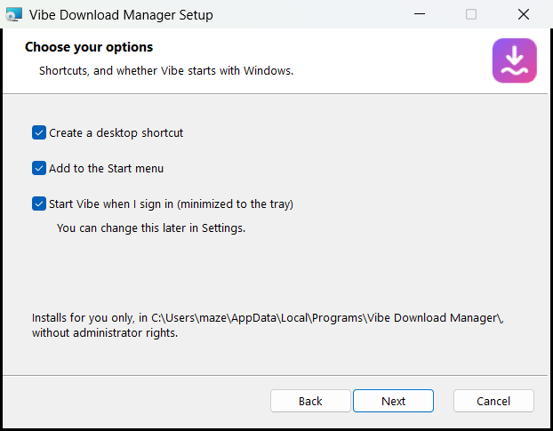
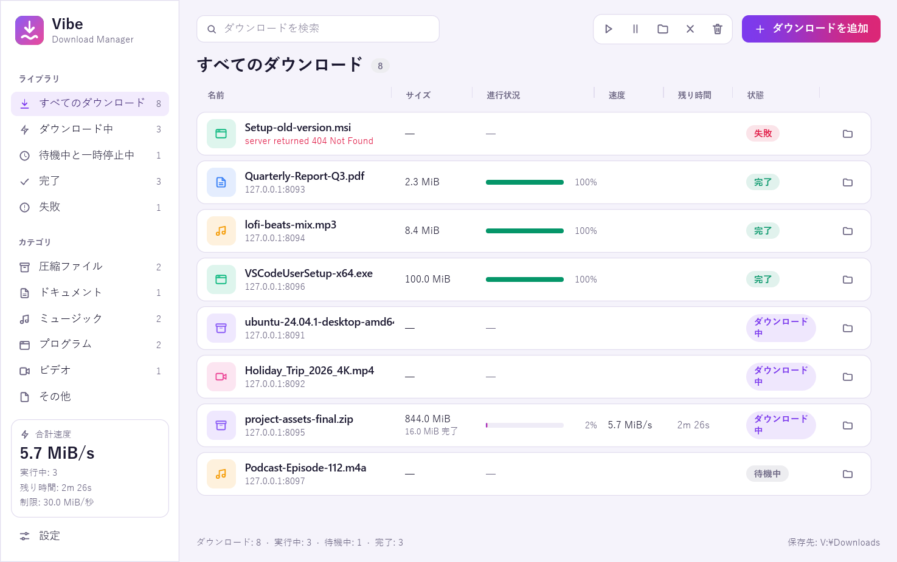

<div align="center">



# Vibe Download Manager

**A fast, free and open-source download manager, written entirely in Rust.**

Multi-connection downloads that resume where they left off, a video stream grabber,
browser integration and a clean desktop app, in 12 languages.

[](#license)
[](https://www.rust-lang.org)
[](#install)
[](#languages)

[Install](#install) · [Features](#features) · [Usage](#usage) · [Browser extension](#browser-extension) · [Build from source](#build-from-source) · [Contributing](#contributing)

<br>

<picture>
  <source media="(prefers-color-scheme: dark)" srcset="docs/images/main-dark.png">
  
</picture>

</div>

## Why Vibe?

Vibe brings the speed of classic download accelerators to a modern, native app: no
Electron, no ads, no telemetry. It splits each file into many connections, keeps going
after crashes and lost connections, picks up the files and video streams your browser
finds, and stays out of the way in the tray.

## Features

**Fast, reliable downloads**
- Up to 32 connections per file, with segments that split again as connections finish, so the slowest part never holds the rest back.
- Resume after a pause, a crash, a reboot or a lost connection. Changes on the server are detected (ETag / Last-Modified) before resuming.
- Falls back to a single stream for servers that don't support ranges.
- Named queues, each with its own limit on simultaneous downloads, speed limit and daily schedule (for example 01:00–07:00 on weekdays), plus a global speed limit.
- When a queue is done, Vibe can close, put the computer to sleep, hibernate or shut it down, after a countdown you can cancel.
- HTTP, HTTPS and FTP (with resume).

**Video streams**
- Saves HLS (`.m3u8`) and DASH (`.mpd`) streams: picks the quality, fetches segments in parallel, decrypts AES-128, and joins audio and video into one `.mp4` (with `ffmpeg` on your PATH).

**Browser integration**
- Extension for Chrome, Edge, Brave and Firefox. It takes over browser downloads, with the right cookies, referrer and user agent.
- "Download with Vibe" in the context menu, and a list of the video streams the current page plays.

**Everyday comfort**
- Sorts downloads into folders by type (Video, Music, Documents, Compressed, Programs).
- Offers to download links you copy to the clipboard, while its window is open.
- Tray icon, desktop notifications, and a single instance: new links go to the running app.
- Optionally starts when you sign in, quietly minimized to the tray.
- Sidebar filters, search, and per-type categories.
- Select many downloads at once (Ctrl+click, Shift+click, Ctrl+A) to pause, resume, remove or delete them together; open any download's folder straight from its row.
- Columns you can resize, drag into a new order, hide, fit to the window or size to their content. Right-click the column titles for the menu.
- Total time left across everything that's downloading.
- A details panel for each download: a live map of its pieces and connections, a speed graph, the server's answers, the request it sent (cookie values hidden) and what happened to it.
- Light and dark themes that follow the system.
- Interface in 12 languages.

**Power-user extras**
- Proxy support: system, HTTP or SOCKS5.
- Per-site logins, sent only to matching hosts. Passwords stay in the OS credential store.
- Checksum check (MD5, SHA-1, SHA-256, SHA-512) after a download.
- Run a command after each download, for example a virus scan.
- Import links from a text file, and export your list.
- A command-line client (`vdm`) for scripts and servers.
- Silent automatic updates on Windows.

<div align="center">
  
  
  
  
</div>

## Install

### Windows

Download the latest `VibeDownloadManager-<version>-x86_64.msi` from the
[Releases](../../releases) page and run it. It installs for your user only, so it doesn't
need administrator rights, and it updates itself silently when a new version comes out,
keeping the options you chose.

The installer asks whether to create a desktop shortcut, add Vibe to the Start menu, and
start it when you sign in, and offers to launch it when it's done. It also adds:
- the `vdm` command-line client to your PATH;
- the browser connection for Chrome, Edge, Brave, Chromium and Firefox. Install the
  [extension](#browser-extension) to use it.

For an unattended install, pass the options as properties, for example
`msiexec /i VibeDownloadManager-0.1.0-x86_64.msi /qn DESKTOPSHORTCUT="" AUTOSTART=1`
(an empty value turns an option off).

### macOS and Linux

The code builds on macOS and Linux, but there are no packages yet. Linux doesn't have a
tray icon yet. See [Build from source](#build-from-source).

## Usage

### Desktop app

Click **Add download** (or copy a link and Vibe offers to download it), choose a folder
and press **Download**. Select one or more downloads (Ctrl+click, Shift+click, Ctrl+A) and
use the toolbar to pause, resume, show in the folder, remove or delete them; Delete and
Esc work too. Right-click the column titles to fit, size, move, hide or reset columns, or
drag a title to move it and its right edge to resize it.

Queues live in the sidebar. Click **New queue** to make one, set when it may download and
what happens when it's done, then add downloads to it from the Add dialog or move selected
downloads with the toolbar's **Move to queue** button. **Start** and **Stop** above the list
run or hold a queue by hand.

Press the **Details** button (or Ctrl+I) to open the details panel, then select a download
to watch its pieces fill, see its speed over the last 90 seconds and read its activity.

The sidebar filters by state and file type, and the search box finds downloads by name or
address. Everything else lives in **Settings**: download folder, how many downloads run at
once, connections per file, speed limit, theme, language, proxy, site logins and updates.

### Command line

```bash
# Download a file with 16 connections into ~/Downloads
vdm get -c 16 -o ~/Downloads https://example.com/big-file.iso

# Run the same command again to resume an interrupted download
vdm get -c 16 -o ~/Downloads https://example.com/big-file.iso

# Grab a video stream at up to 720p
vdm get -q 720 https://example.com/video/master.m3u8

# Limit speed, verify a checksum, use a proxy
vdm get --limit 2M --checksum sha256:9f86d0… --proxy socks5://127.0.0.1:1080 https://example.com/file.zip

# See what a server reports before downloading
vdm probe https://example.com/file.zip
```

Run `vdm --help` or `vdm get --help` for every option.

## Browser extension

The extension isn't in the browser stores yet. Download
`VibeDownloadManager-extension-<version>.zip` from the [Releases](../../releases) page and
unzip it (or use the [`extension/`](extension) folder of a source checkout). It needs the
browser connection, which the Windows installer sets up; when running from source, register
it yourself with `vdm-nmhost install`. Then:

- **Chrome, Edge, Brave:** open `chrome://extensions`, turn on **Developer mode**, click
  **Load unpacked** and pick the unzipped folder.
- **Firefox:** open `about:debugging#/runtime/this-firefox`, click **Load Temporary Add-on**
  and pick `manifest.json` in the unzipped folder.

Its popup shows whether Vibe is reachable, the video streams found on the page, and
whether to capture browser downloads. See [`extension/README.md`](extension/README.md) for
details.

## Languages

English, Español, Français, Deutsch, Português (Brasil), Italiano, Русский, Türkçe, Polski,
简体中文, 日本語 and 한국어. Vibe picks your system language on first start; change it any
time in **Settings → Appearance → Language**.

<div align="center">
  
</div>

To add or improve a translation, edit the files in
[`crates/vdm-gui/locales/`](crates/vdm-gui/locales) (the app) and
[`extension/_locales/`](extension/_locales) (the extension). English is the source; the
tests check that every language has every string with the same `{placeholders}`.

## Build from source

You need [Rust](https://rustup.rs) 1.88 or newer. On Linux you also need your
distribution's development packages for windowing and D-Bus (for example
`libxkbcommon-dev`, `libwayland-dev` and `libdbus-1-dev`). TLS uses rustls, so OpenSSL
isn't needed.

Clone the repository, then in its folder:

```bash
cargo build --release
```

The programs land in `target/release/`:

| Program | What it is |
|---|---|
| `vdm-gui` | The desktop app |
| `vdm` | The command-line client |
| `vdm-nmhost` | The browser connection (run `vdm-nmhost install` once) |

`ffmpeg` on your PATH is optional: with it, video streams are joined into a single `.mp4`.

### Project layout

| Crate | Purpose |
|---|---|
| [`vdm-core`](crates/vdm-core) | The download engine: probing, segments, workers, speed limits, queue, HLS/DASH, FTP |
| [`vdm-gui`](crates/vdm-gui) | The desktop app ([iced](https://iced.rs)), tray, notifications, translations, updates |
| [`vdm-cli`](crates/vdm-cli) | The `vdm` command-line client |
| [`vdm-media`](crates/vdm-media) | HLS and DASH playlist parsing |
| [`vdm-store`](crates/vdm-store) | The download list in SQLite |
| [`vdm-ipc`](crates/vdm-ipc) | Single instance and the link to the browser connection |
| [`vdm-nmhost`](crates/vdm-nmhost) | The browser's native messaging host |
| [`vdm-proto`](crates/vdm-proto) | Types shared by all of the above |
| [`vdm-testsrv`](crates/vdm-testsrv) | An HTTP test server with fault injection, used by the tests |
| [`xtask`](xtask) | Project tasks: `cargo xtask icons`, `cargo xtask dist` (signed MSI and update manifest), `cargo xtask site` (website) |
| [`site`](site) | The website and blog: pages, Markdown posts, styles |

### Tests

```bash
cargo test --workspace                                     # Rust tests
cargo clippy --workspace --all-targets -- -D warnings      # lints
node --test "extension/test/*.test.js"                     # extension tests
```

### Releases

`cargo xtask dist` builds the release programs, the Windows installer and the update
manifest (`latest.json`). Pushing a tag like `v0.2.0` runs the
[release workflow](.github/workflows/release.yml), which publishes them to GitHub Releases.
To sign the builds, add a code-signing certificate as the `WINDOWS_CERT_PFX` (base64) and
`WINDOWS_CERT_PASSWORD` repository secrets.

### Website

The project website and blog live in [`site/`](site). Pages are HTML with a short TOML
header; blog posts are Markdown files in [`site/blog/`](site/blog). Build and preview it with:

```bash
cargo xtask site
python -m http.server 8000 --directory target/site
```

Then open http://localhost:8000. The generator also writes the sitemap, RSS feed,
`robots.txt` and structured data for search engines. Pushing to `main` publishes it with the
[website workflow](.github/workflows/pages.yml). In the repository settings, set Pages →
Source to "GitHub Actions" once.

## Roadmap

- macOS and Linux packages, and the Linux tray icon
- Live streams, multi-period DASH, FTPS
- More languages, including right-to-left ones

Ideas and bug reports are welcome in [Issues](../../issues).

## Contributing

Contributions are welcome: code, translations, bug reports and ideas.

1. Fork the repository and create a branch.
2. Make your change, with tests where it makes sense.
3. Run the [tests](#tests), `cargo fmt` and clippy.
4. Open a pull request that explains what changed and why.

Unless you say otherwise, any contribution you submit is dual-licensed as below, without
any additional terms or conditions.

## License

Vibe Download Manager is licensed under either of

- [Apache License, Version 2.0](LICENSE-APACHE)
- [MIT License](LICENSE-MIT)

at your option.

## Acknowledgements

Built on [iced](https://iced.rs), [tokio](https://tokio.rs), [reqwest](https://github.com/seanmonstar/reqwest),
[rusqlite](https://github.com/rusqlite/rusqlite), [suppaftp](https://github.com/veeso/suppaftp),
[tray-icon](https://github.com/tauri-apps/tray-icon) and many other excellent crates.
Inspired by the download managers that came before it.
